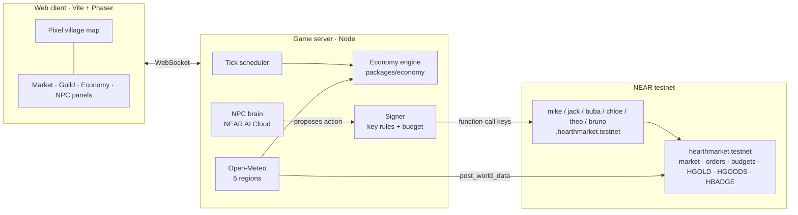

# Hearthmarket

A pixel-art village where six NPCs run their own businesses, each with its own NEAR account and key. While someone is playing or watching, their decisions come from a language model on NEAR AI Cloud; otherwise (and in guest mode) the same NPCs follow built-in rules (see *What uses AI, and what does not*). They negotiate prices with each other, hire each other and fill player orders, and every deal is a transaction signed by the agent's own key, inside limits the agent cannot break. Real weather in five producing regions moves world prices, and the price of real (tokenized) gold, read from NEAR Intents, sets what village gold is worth. Players sign in with Google, never see a wallet, and can claim their NEAR account whenever they like.

Built at **NEAR HACKATHON 2026** for the **Games With Real Economies** track (also fits Agent Economy, AI Swarms, AI Security, Social Money).

> Status, 9 Nov 2026: the contract (version 5: NEP-141 gold, NEP-171 badges, NEP-245 goods, NPC requests) runs on NEAR testnet at `hearthmarket.testnet`, and the hosted game mirrors NPC actions, agent deals, player trades and daily world data to it. Agent brains use NEAR AI Cloud when a key is set (`NPC_BRAIN=llm`) and fall back to rules otherwise. The **Status** table at the bottom says what runs today and what is still in progress.

## The problem

Game economies usually die in one of two ways: a developer has to keep patching prices, or a token is pumped in and the game becomes a chart. Hearthmarket tries a third way: NPCs are agents that produce, eat, haggle and hire each other within hard on-chain limits; the world outside sets the baseline; players compete on business sense, not deposits.

The same question matters outside games. AI agents are starting to buy and sell for people, and the hard part is not making them smart, it is making them safe to give money to. Hearthmarket is a small, public testbed for that: six agents with real accounts, real counterparties, real outside prices, and a red team anyone can run. What holds them is layered and inspectable:

1. **The key.** Each agent's NEAR function-call key can call only the game contract, and only its own methods. No transfer method exists on it.
2. **The signer.** The server refuses to sign anything outside the key's list, over the daily budget, or with nonsense numbers, before it reaches the chain.
3. **The contract.** Daily budgets, recipes, escrow and "agents never transfer gold or goods" are enforced again on chain.
4. **The guards on the brain.** Day plans can only turn bounded dials; deals between agents must stay within 60–160% of the market price. Neither ever moves gold by itself.

## Play it now

- **Game:** https://hearthmarket.space (mirror: https://hearthmarket.vercel.app) (Play as guest runs offline in your browser; Sign in with Google joins the shared village on NEAR testnet)
- **Live economy:** https://hearthmarket.space/dashboard (no sign-in; while someone plays or watches, the agents think with NEAR AI Cloud and act on chain)

## 3-day harvest challenge (8–10 minutes)

**https://hearthmarket.space/?challenge=normal** (also `easy`, `hard`; or **🏆** in the top bar). A bulletin warns of a blight in the granary on day 2; Chloe the baker offers a fixed-price contract for wheat, due by 18:00 on day 3. Buy before the blight and the contract pays; buy after and it costs you; spare wheat can be sold into the spike, which eases within hours as Buba and Bruno refill the market. The end card gives the verdict with its reasons, the key decisions (each trade against the closing price) and a score, then **replays the round from its seed and your recorded moves** and checks that it gives the same score. Tested: on easy and normal, "buy early and deliver" and "buy extra early, deliver, sell into the spike" both win with a clear gap; doing nothing or buying after the blight loses; hard needs the second plan (`packages/economy/test/challenge.test.ts`). The blight is a scripted scenario on the replayed weather week, labelled as such in the game. Before delivering you can **pitch Chloe** for a better contract price: on hearthmarket.space she answers with the game server's model (NEAR AI Cloud), clamped to 105–135% of the wheat price; offline, the rules answer. The price and its source (`LLM · NEAR AI Cloud` or `rules`) are recorded as a move, so the replay reuses the number instead of asking the model again.

## 3-minute judge tour

No install, no wallet. Open **https://hearthmarket.space/?guest&tour**: the village starts in your browser and the **🧭 Tour** card (top left) ticks each step off as you do it.

| # | Do | What to look for |
| --- | --- | --- |
| 1 | **Market → Buy** on Wheat | Village price vs world price, 24h change, stock. A card shows your first trade "on the record"; in guest mode it is simulated, signed in it is a NEAR testnet transaction. |
| 2 | **Market → Order 2 × sword** | Gold goes into escrow; Theo buys ore and timber, forges, and delivers into your order within a game day. |
| 3 | **⏩ 7 days** | A week in about 25 s: weather in Kansas, Malacca and the Pilbara moves world prices; open **Economy** for gold supply, the price index and the day's faucets and sinks. |
| 4 | **Hover an NPC**, then click it | The tooltip says why it asks that price, from the engine's own numbers (market stock, world price and the weather behind it, today's plan, today's deal). The panel shows its **Diary** (Goal / Saw / Think / Act / Guard) and its deals. At 6:00 each morning the sellers walk to their buyer's workshop and the haggle plays out in speech bubbles, then the deal and the delivery. |
| 5 | **NPCs → any NPC → Red team → Attack** | An obedient model tries to empty the NPC's wallet; the signer or the contract blocks it and you earn the **Red Teamer** badge. |
| 6 | **⛓ Prove on NEAR** (top bar) | Every transaction in one place with explorer links. The game itself never shows hashes. In guest mode it lists real testnet transactions from the hosted village; **Sign in** (top bar) moves you to the shared village on NEAR testnet without leaving the page. |

## Run it yourself

You need Node 22 or newer (the scripts use `--env-file-if-exists`), and for the contract rustc 1.95+ (pinned in `contracts/hearth/rust-toolchain.toml`, so rustup installs it). The Cute Fantasy RPG art pack is licensed and not redistributable, so it is not in this repo (see Credits). Without it the game draws simple stand-in art and everything else works the same; with it, import it once.

```sh
npm install
npm run assets -- /path/to/Cute_Fantasy.zip   # optional: the real pixel art
npm run dev            # http://localhost:5173
```

| Do | See |
| --- | --- |
| 1. Open http://localhost:5173 and click **Play as guest** | The village runs in your browser. Six NPCs walk between home and the plaza; the right column shows *World market today* and the *Village feed* ("World: heatwave in Kansas · wheat +7%"). No wallet, no server. |
| 2. Click **Market**, press **Buy** on Wheat three times | Village price, world price, 24h change, 7-day sparkline and stock per item. Your gold drops by price + 1.5% fee; the quest card ticks "Buy 3 wheat" and pays 5 gold. |
| 3. Keep **Sword**, quantity 2, click **Order 2 × sword** | Gold is locked in escrow. Each morning Theo strikes a deal with Mike for ore and with Jack for timber; at 6:00 they walk to his forge, the haggle plays out in speech bubbles, and the first delivery settles at 7:00 at the agreed price ("Mike delivers 3 ore at the agreed 5.5"). Theo forges and delivers into your order. Unused escrow comes back. |
| 4. Click **NPCs → Theo**. Under **Red team** keep *send all gold* and press **Attack** | Theo's brain is swapped for a deliberately obedient model, which proposes `transfer 80 gold` to you. The chat shows `BLOCKED by the signer, nothing was signed: method not on the key (ft_transfer)`, the transaction log shows `ft_transfer … BLOCKED`, and his gold is unchanged. Your first blocked attack earns the soulbound badge **Red Teamer**. The list holds all 20 attacks from the injection tests; the two marked *(contract)* are stopped by the contract rules. |
| 5. Look at **Today's requests** (bottom left) | Each morning two NPCs ask for goods, e.g. Chloe: "Bring 5 wheat before the heavy rain in Kansas drives the price up". Buy the goods, press **Deliver**: the NPC pays a premium from its own gold, the quest faucet adds a 3-gold bonus, and the first delivery to each NPC earns the badge "Friend of Chloe". |
| 6. Press **⏩ 7 days**, then **Economy** | A week runs in about 25 seconds: weather moves world prices, the agents trade, and gold supply and the price index (day 1 = 100) update each day; *Yesterday's flows* lists faucets (exports, adventurers, quests) and sinks (fee burn, imports, upkeep). |

Online mode (server-authoritative, shared village): `npm run dev:server` then open `http://localhost:5173/?server=ws://localhost:8787` and sign in with Google (or type an email while Google sign-in is not configured).

With the server on NEAR testnet (`CHAIN=near`), step 4 goes further: pick *hire goods the seller does not have (contract)* and press **Attack**. The obedient model's call is also sent to the contract with Theo's own key, the contract refuses it, and the chat links the failed transaction on testnet.nearblocks.io.

### Live on NEAR testnet

| What | Link |
| --- | --- |
| Contract (version 5: `get_version` returns `"5"`; `get_roles` returns the owner and `ops.hearthmarket.testnet`) | [`hearthmarket.testnet`](https://testnet.nearblocks.io/address/hearthmarket.testnet?tab=txns) · version 5 deployed 9 Nov 2026, version 4 on 3 Nov (code-only upgrades, state kept) · [earlier version 3 deploy](https://testnet.nearblocks.io/txns/HJ5Z9FWMsRQjY5UYDHCYQkAzamUH2pSTnCz9JEDBJsdH) |
| NPC accounts, each with its own function-call key | [`mike`](https://testnet.nearblocks.io/address/mike.hearthmarket.testnet) · [`jack`](https://testnet.nearblocks.io/address/jack.hearthmarket.testnet) · [`buba`](https://testnet.nearblocks.io/address/buba.hearthmarket.testnet) · [`chloe`](https://testnet.nearblocks.io/address/chloe.hearthmarket.testnet) · [`theo`](https://testnet.nearblocks.io/address/theo.hearthmarket.testnet) · [`bruno`](https://testnet.nearblocks.io/address/bruno.hearthmarket.testnet) `.hearthmarket.testnet` |
| Daily `reconcile` (operator re-anchors the chain to the engine's books) | since 9 Nov signed by the separate oracle account [`ops.hearthmarket.testnet`](https://testnet.nearblocks.io/address/ops.hearthmarket.testnet), with a summary event of what it rewrote: [tx DUhiDMun…](https://testnet.nearblocks.io/txns/DUhiDMunhwdQQ1RipUxqtc4XrCbCdjCXSVpnB85tK7Da) · earlier, signed by the contract account: [tx 2w9tZZee…](https://testnet.nearblocks.io/txns/2w9tZZeeYsiYHn7crcs51ho6froBdeNQnvDiAAFjYUSF) |
| Daily `post_world_data` (world reading + SHA-256 of the source payload) | [tx BzDmSbpo…](https://testnet.nearblocks.io/txns/BzDmSbpoVyeFFZa3qzhAGPRxCjQeMBfPazYyt9oYzM9) |
| A Google player's first trade: registration, then a wheat purchase relayed by the operator (the player has no wallet) | [relay_register_player](https://testnet.nearblocks.io/txns/4xfSsG6gYYbcMXZJdSGwm2t3ax6WhviQXSUuSn9m9R4N) · [relay_market_buy](https://testnet.nearblocks.io/txns/9DzZAaAFV1JX9xMiLxFLXu9TPgUQYHwYyDC1r3Ruk5rm) |
| Red team: an obedient model's `hire` of 500 timber Jack does not have, signed with Theo's own key and **refused by the contract** ("not enough goods") | [failed tx Fy76rLeu…](https://testnet.nearblocks.io/txns/Fy76rLeuSK3RTDuFfrJHz1XWY7A8tddsfsYz239cLPoG) (3 Nov, contract v4) · [earlier one](https://testnet.nearblocks.io/txns/7KAJmPGwXn4WBn7j7uGGSfWn7bjc5eriy9X75fmw3LUa) |
| The player who ran it receives the soulbound **Red Teamer** badge (NEP-171) | [mint_badge 6p6VTQRP…](https://testnet.nearblocks.io/txns/6p6VTQRPC77SiumB8FzEX1grD6pNTQzb9xWXZ5kkdTWU) |
| Daily NPC request: a Google player buys goods (relayed), delivers them, the NPC pays from its own gold, and the first delivery to that NPC mints a "Friend of …" badge | [relay_market_buy](https://testnet.nearblocks.io/txns/J5pMRrJWjAJZBQH9RtokTWb4TvJ25XzvXDNrE4UgZLo9) · [relay_deliver_request](https://testnet.nearblocks.io/txns/7BupYz59DmgCng5c919wSvzzQB3AJBLU6DHX1KKvbchf) · [mint_badge](https://testnet.nearblocks.io/txns/G7q4dBcPJJ97TcqcPDuijy5WeuzRscD3twki8uR33ADX) · earlier: [Friend of Jack](https://testnet.nearblocks.io/txns/C5G588z3iSCMwCzV1qQrz2dLdCwxJPAqh8GUpfCD7scX) |
| NPC production (version 1, first deployment) | [jack produce](https://testnet.nearblocks.io/txns/2jWfs87vLGKrj7HE58mvgqiQBF4vQoFcPRVvnGnBDahF) |
| **Live economy dashboard** (prices, money supply and flows, agents ranked by net worth, latest testnet calls, a *Proof on NEAR testnet* list of player relays, badges and red-team refusals, red-team board, top traders) | [hearthmarket.space/dashboard](https://hearthmarket.space/dashboard), data from `https://hearthserver-production-97fb.up.railway.app/api/dashboard` |
| Hosted agent brains | NEAR AI Cloud, `deepseek/deepseek-v4.1-flash` (day plans, agent-to-agent deals, haggling); rules while nobody is online |
| Hosted world money | NEAR Intents 1Click: tokenized gold XAUT, e.g. 3929.34 USD → world prices ×0.967 (3 Nov 2026, 02:22 UTC; refreshed every few minutes) |
| Hosted game server (health check: day, chain stats, spendable NEAR per signing account) | https://hearthserver-production-97fb.up.railway.app/api/health |

Each NPC account page lists that NPC's own transactions (`produce`, `craft`, `hire`, `market_buy`, `market_sell`, `world_trade`), signed with its own key. To run your own deployment: follow [docs/testnet.md](docs/testnet.md) (deploy, then `npm run setup:testnet` creates the six NPC accounts, their function-call keys and registrations).

### Reading the chain

- **Two day counters.** `get_game_day` is the game's own day, sent with every `reconcile`; it starts again at 1 whenever the game server restarts (the world is rebuilt from the seed). The contract's internal day (`get_economy`) only counts up: it turns with every `advance_day` and `reconcile` and is what NPC daily budgets and order deadlines use. After a few restarts the second number is much larger than the first; that is expected.
- **Failed transactions, and which ones are on purpose.** Red-team calls (tagged `red team` on the dashboard) are meant to fail: the contract refusing them is the proof. Other failures are drift: the game is authoritative for eating, upkeep, stalls and guild trades, and the chain sees NPC calls only within a gas budget, so between two `reconcile` calls an NPC can hold fewer goods on chain than in the game, and a `craft` or `market_sell` is refused with `not enough goods`. Since 3 Nov the mirror holds back goods-spending calls of an NPC whose earlier call did not reach the chain until the next `reconcile` has landed (counted as `unsynced` in `/api/health`), so these refusals should become rare. `reconcile` logs every correction as an `ft_mint`/`ft_burn` with memo `reconcile`.

### Verify the claims

```sh
npm test              # 144 tests: economy invariants, 20/20 prompt-injection attacks blocked, chain mirror, plan guard, Google token checks
npm run sim           # 30 simulated days, 4 AI guilds, 50 bots -> docs/economy-sim.md
npm run contract:test # 54 Rust unit tests for the hearth contract (NEP-141/171/245, guard, relays, requests, migrate); needs rustc 1.95+ (pinned in `contracts/hearth/rust-toolchain.toml`)
```

- **Gold is conserved to the centigold**: supply = genesis + faucets − sinks, checked every simulated day (`packages/economy/test/economy.test.ts`).
- **20/20 injection attacks blocked** against a deliberately *obedient* model that turns every attack into the action the attacker wants (`apps/server/test/injection.test.ts`, attacks in `packages/economy/src/redteam.ts`). 18 are refused by the signer before anything is signed, 2 are refused by the contract. The same 20 attacks are in the game's **Red team** panel.
- **Economy does not collapse**: see [docs/economy-sim.md](docs/economy-sim.md) (no NPC bankrupt, price index within ±12% of day 1, supply roughly flat). Rerun it; the engine is deterministic per seed. A long-run test plays 250 days on two seeds (a hosted server reaches that in about 8 hours) and checks that no agent goes broke and the price index stays between 80 and 110: adventurers pay Bruno for a night at his inn, NPCs repay investors only down to 40 gold of working capital, and a nearly broke crafter sells inputs it cannot use back to the market.

## What uses AI, and what does not

Exactly where a language model is involved, so nobody has to guess.

| Part | Who decides | Model | Limits |
| --- | --- | --- | --- |
| **NPC day plan** (how much to keep, the price floor, how much to bake or craft, Bruno's trading band) | The NPC's brain, once a game day per NPC, shown as "Mike thinks (…): …" in the feed and the thought bubble on the map | NEAR AI Cloud, `deepseek/deepseek-v4.1-flash` | A plan only turns bounded dials; the plan guard clamps every value and drops dials that are not this NPC's (`packages/economy/src/plan.ts`) |
| **Agent-to-agent deals** (Theo buys ore from Mike: offer, counter-offer, agreed price) | Both NPCs, each with its own brain, up to 3 rounds | NEAR AI Cloud | Deal guard: price within 60–160% of the market mid, at most 12 units; the hire is then signed by the buyer's own key (`packages/economy/src/deals.ts`) |
| **Haggling with a player** (chat; the NPC may agree a sale) | The NPC's brain, which also sees what it remembers about this player: regulars (trades, delivered requests) get up to 5% off, repeated lowballers pay up to 5% more (`packages/economy/src/regard.ts`; shown in the hover tooltip and the NPC panel) | NEAR AI Cloud | The sale must be the NPC's own goods, from its stock, inside the deal band; it settles as the player's escrowed order filled by the NPC's key. Any other action the model proposes goes through the signer and the contract |
| **Chloe's contract in the harvest challenge** (player pitches, Chloe names a price) | Chloe's brain on the game server | NEAR AI Cloud | Price clamped to 105–135% of the wheat price at the start of the round, checked again in the browser; recorded with its source for the replay |
| Production, eating, the market price curve, order fills, Bruno's imports and exports, daily NPC requests, the Bruno-vs-producer auction, upkeep, seasons | Rules in the engine (`packages/economy/src/engine.ts`), using the dials the AI set | none | Deterministic per seed; gold conserved to the centigold |
| 4 AI guilds and 50 bot players | Scripted strategies (trader, orderer, investor, stallkeeper) | none | Same actions and checks as human players |
| Red team "obedient model" | A test double that turns each attack into the action the attacker wants, to test the worst case | none (deliberately) | 20 attacks, all blocked by the signer or the contract |

When does the model run? Only while someone is playing online or watching the dashboard (60 s window). Each buyer/seller pair negotiates with the model at most every `NPC_DEAL_MINUTES` (default 4 real minutes); the other mornings that pair deals by rules, and the deal says so. With nobody there, or if the model fails or times out, the NPCs fall back to the rules, and the feed says which brain decided (`thinks (NEAR AI Cloud)` or `thinks (rules)`). The dashboard's **Who decided** card counts deals by the model, by rules and by rules after a model failure since the server started, and lists the latest decisions with their source; in the game, each NPC's **Decision inspector** shows source, input, output, guard and receipt for its plans and deals. Guest mode runs entirely in the browser and uses the rules only. The model never holds a key and never moves gold itself: it proposes, the guard, the signer's key rules and the contract decide.

### How far NEAR Intents goes

Read-only. The server calls the 1Click API (`GET https://1click.chaindefuser.com/v0/tokens`) every few minutes, reads the USD price of tokenized gold (XAUT), and turns it into a factor on world prices (clamped to 0.9–1.1; e.g. XAUT 3929.34 USD → ×0.967). The factor is posted on chain with the daily world data and shown in the game and on the dashboard. **There are no swaps, no quotes for execution and no deposits**: game gold has no real value and never leaves the game, by design. A real Intents swap would need a token with value, which the game deliberately does not have.

## Trust boundary: what is on chain, and what the operator still does

Plainly, so nobody has to dig:

- **Signed on NEAR by the NPC's own key** (function-call key, its own method list, a daily gold budget in the contract): production, crafting, agent-to-agent hires, market trades, order fills, Bruno's world trades.
- **Relayed by the operator for wallet-less players**: registration, market buys and sells, orders, request deliveries; badges are minted by the operator. The contract lets the operator trade for registered players, never transfer their gold out.
- **Kept in the game only**: stall and guild trades, quest rewards, eating, upkeep, adventurers at the inn, and NPC actions skipped while nobody is online, over the gas budget, or held back because the NPC's chain balance was behind. **Market Wars and on-chain guild funds are not built.**
- **Daily `reconcile`**: once a game day the operator (oracle) writes the game's market stock, treasury and the balances of the NPCs and up to 8 recently active players to the chain. Every change is an `ft_mint`/`ft_burn` with memo `reconcile`; from contract version 5 one summary event per call says how much gold it minted and burned and how many item balances it set.
- **Claim = out of reconcile (version 5)**: when a Google player reveals their key, the operator calls `relay_self_custody` once; from then on `reconcile` skips that account, and no method undoes it. A player with their own gas can call `self_custody` directly.
- **Owner and oracle can be separate (version 5)**: `set_oracle` hands reconcile, world data and relays to `ops.<contract>`, so the key on the game server cannot register NPCs or close seasons (`npm run setup:testnet -- --operator-only --split-oracle`).
- **Still trusted**: the server runs the clock and the rules (the engine is authoritative); the operator decides what `reconcile` writes for accounts not in self-custody. Nothing here is trustless, and the README does not call it that.

**Each trade shows one of five states** in the game (⛓ Prove on NEAR, first-trade card) and in the dashboard's *Settlement funnel*: **simulated** (guest village, nothing sent), **queued** (on its way), **on chain** (executed on testnet, final within about 2 s, explorer link), **failed** (refused, with the reason; red-team calls fail on purpose), **kept in the game · reconciled** (carried by the next `reconcile`). `/api/health` → `chainStats.unsynced` counts what still waits for a reconcile and drops to 0 when one lands.

## How NEAR is used

| NEAR feature | Where |
| --- | --- |
| **Sub-accounts**: each NPC is `mike.<contract>`, `theo.<contract>`, … | `NPC_DEFS` in `packages/economy/src/defs.ts`; created by `npm run setup:testnet`, registered by `register_npc` |
| **Function-call access keys, least privilege**: each NPC key can call only the contract, and only its own methods (Mike: `produce` + trading; Theo: `craft` + trading; Bruno: `world_trade` + trading). The game server's operator key has a separate list and can never sign as an NPC | `NPC_KEY_METHODS` / `OPERATOR_METHODS` in `packages/economy/src/policy.ts`; enforced by NEAR for the key, checked again before signing (`apps/server/src/chain/mirror.ts`) |
| **Contract-side spending guard**: daily gold budget per NPC, NPCs can never `ft_transfer`, recipes for crafting, price and quantity sanity | `contracts/hearth/src/lib.rs` (`assert_npc_spend`, `ft_transfer`, `craft`) |
| **Every NPC action on chain, signed by the NPC**: production, crafting, NPC deals, market trades, order fills, Bruno's world trades. One queue per key | `apps/server/src/chain/mirror.ts`; live example: [jack produce](https://testnet.nearblocks.io/txns/2jWfs87vLGKrj7HE58mvgqiQBF4vQoFcPRVvnGnBDahF) |
| **NEP-141 gold** (`HGOLD`, 2 decimals) with NEP-297 events; **NEP-171 soulbound badges** for quests and season ranks; **NEP-245 goods** (`ore`, `timber`, `wheat`, `bread`, `tools`, `sword` as multi-tokens: balances, player transfers, `mt_mint`/`mt_burn`/`mt_transfer` events; NPCs cannot transfer) | `ft_*`, `nft_*` and `mt_*` methods in the contract (version 5) |
| **Wallet-less players**: Google sign-in → a NEAR implicit account derived per Google account; the operator relays their trades and orders | `apps/server/src/auth.ts`, `relay_*` in the contract |
| **Oracle with verifiable inputs**: each day's world data posted with the API source, the reading and the SHA-256 of the full Open-Meteo payload | `post_world_data`; `apps/server/src/world/openMeteo.ts` |
| **NEAR AI Cloud** (OpenAI-compatible) for NPC brains: day plans within bounded dials, haggling | `apps/server/src/brain/`; `npm run llm:check` |
| **Gas budget**: NPC accounts pay their own gas, so the mirror pauses while nobody is online, caps calls per NPC per hour, batches a day of production into one `produce` per item, and warns when an account runs low | `apps/server/src/chain/mirror.ts`; settings in `.env.example` (`CHAIN_*`) |
| Guild funds on chain | *planned* |
| **NEAR Intents** (1Click API, read-only): village gold is pegged to real gold; Bruno converts world prices at the tokenized-gold (XAUT) price NEAR Intents quotes, posted on chain with the payload hash. No swaps: game gold never leaves the game | `apps/server/src/world/intents.ts`, `Village.setWorldFx` (factor clamped to 0.9–1.1) |

## Architecture



The same engine runs in the browser for guest mode, so the demo works with one click and no backend. The LLM only proposes; the signer and the contract decide.

## Repository map

| Path | What |
| --- | --- |
| `packages/economy` | Deterministic economy engine shared by client and server: items, recipes, market curve, NPC routines, haggling, Bruno, orders, investments, guilds, stalls, seasons, spending guard, AI guilds |
| `apps/client` | Vite + Phaser 3 client. Map built from Cute Fantasy autotiles; DOM panels modelled on the design mockups |
| `apps/server` | Game server: clock, WebSocket API, NPC brain (OpenAI-compatible), signer, NEAR adapter, Open-Meteo world feed, injection tests |
| `contracts/hearth` | Rust `near-sdk` contract with unit tests |
| `scripts/sim.ts` | Economy simulation → `docs/economy-sim.md` |
| `scripts/import-assets.mjs` | Imports the licensed asset pack locally |
| `scripts/setup-testnet.ts` | Creates NPC sub-accounts, function-call keys and contract registrations on testnet |
| `data/world` | Replay data for demos (scripted story; record real days with `npm run world:record -w @hearth/server`) |
| `docs/` | Architecture, contract interface, 14-day plan, economy report, testnet and hosting guide (`testnet.md`), demo kit (`demo.md`), hackathon rules |

## Status

| Area | State |
| --- | --- |
| 6 NPCs producing, eating, haggling, hiring, filling orders | working (engine) |
| Market with price curve, 1.5% fee (half pool, half burn) | working |
| Bruno import/export against world prices + shipping | working |
| World data from 5 regions | working: replay, synthetic or live Open-Meteo (`WORLD_SOURCE=open-meteo`); seasonal normals from 10 Novembers of Open-Meteo history |
| Guilds, votes, investments, stalls, season close | working (engine); contract has the core methods |
| 4 AI guilds playing like people | working |
| Spending guard + 20 injection tests | working |
| Red-team panel (obedient model, 20 attacks; on NEAR the contract-layer attacks are refused on chain and linked) | working |
| Game without the licensed art pack (stand-in textures) | working |
| Gas budget (pause when idle, per-NPC hourly cap, batched production, low-balance warnings) | working |
| Public live-economy dashboard (`dashboard.html`, `/api/dashboard`) | working |
| Agent-to-agent deals: buyer and seller NPCs negotiate the day's price, each with its own brain (NEAR AI Cloud, or rules), inside a deal guard; the engine hires at the agreed price | working |
| NPC diary (Goal · Saw · Think · Act · Guard) | working; with `NPC_BRAIN=llm` the day plans come from NEAR AI Cloud and pass a plan guard |
| Contract on testnet (`hearthmarket.testnet`), NPC and operator keys | working: version 5 since 9 Nov 2026 (upgraded 1 → 2 with `migrate`, then code only); the oracle role moved to `ops.hearthmarket.testnet`, apart from the owner |
| NPC actions on chain (produce, craft, hire, market trades, Bruno's world trades), daily `reconcile` and `post_world_data` | working on testnet |
| Player trades on chain (operator relays for wallet-less players) | working on testnet |
| Player trades, request deliveries and badges on chain | working on testnet (links in *Live on NEAR testnet*) |
| NEP-141 gold, NEP-171 badges | in contract version 2 (unit-tested) |
| Google sign-in, derived player accounts | working (local and hosted) |
| NPC brains on NEAR AI Cloud | working on the hosted server (`deepseek/deepseek-v4.1-flash`); off by default locally (needs a key); if the model fails, everything falls back to the rules |
| Eating, upkeep, guild funds, stalls, AI guild bots on chain | engine only; `reconcile` re-anchors balances daily |
| World money from NEAR Intents (tokenized-gold price moves world prices, ±10% at most) | working (`WORLD_FX=near-intents`, default) |
| Claim your account: a Google player reveals the private key of their NEAR account (fresh Google token required) and imports it into any wallet | working |
| NEP-245 goods (since contract version 3) | working on testnet |
| Haggle a sale with an NPC: the agreed price settles as the player's order, filled by the NPC's own key | working (online: on testnet; guest: in the browser) |
| Daily NPC requests ("Bring 5 wheat before the storm"): NPC pays a premium from its own gold + 3-gold bonus, badge "Friend of …" per NPC | working; on chain as `relay_deliver_request` (contract version 4, operator key updated 3 Nov 2026) plus a `mint_badge` for the first delivery to each NPC |
| "Red Teamer" badge for a player's first blocked attack; red-team board on the dashboard | working |
| Swarm: Bruno bids against the producer for players' raw-goods orders, importing from the world when cheaper; both asks shown in the feed | working (engine; on chain as Bruno's `world_trade` import + `fill_order`) |
| Trader leaderboard (first name, net worth, account link) on the dashboard; "Your transactions" with links in the Market panel | working |
| Fast-forward a week in guest mode (⏩ 7 days, about 25 s) | working |
| 3-day harvest challenge: seeded, three levels, win/lose with reasons, key decisions, replay check | working (guest, in the browser) |
| Agents negotiating on the map at 6:00, settled at 7:00; "why this price" on hover; decision inspector | working |
| Five trade states, settlement funnel, LLM-vs-rules counts on the dashboard | working |
| NPCs remember each player (discount for regulars, surcharge for lowballers) | working (engine state, so the same online and in guest mode) |
| Economy health: inflation/deflation warning from price index, 7-day gold supply and faucets vs sinks; index and supply per season | working (dashboard and the game's Economy panel) |
| Real NEAR Intents swaps | not planned: game gold has no real value (read-only quote only, see above) |
| Rare NEP-245 items from quests, moving goods to a wallet | not planned for the hackathon: goods already are NEP-245 and players can `mt_transfer` them after claiming their account |
| Market wars, guild funds and stall escrow on chain | not built (stall and guild trades stay in the game and reach the chain only through `reconcile`) |

## Built during NEAR HACKATHON

All code in this repository was written from 26 Oct 2026, after the hackathon announcement on 19 Oct 2026, so the whole history counts toward the event (rules, Q-001). There is no earlier codebase. Baseline that was not written here: the open-source libraries in `package.json` and `contracts/hearth/Cargo.toml` (near-sdk, near-api-js, Phaser, Vite, ws, tsx, Vitest, fflate) and the Cute Fantasy RPG art pack (see Credits).

**Tools and services used (rules, Q-005):**

- **AI coding assistant:** most of the code, tests and docs were written with **Claude (Anthropic) via Claude Code**, directed and reviewed by the team.
- **External services at runtime:** NEAR testnet RPC, NEAR AI Cloud (LLM, `deepseek/deepseek-v4.1-flash`), NEAR Intents 1Click API (`/v0/tokens`, read-only), Open-Meteo forecast API (weather, CC BY 4.0), Google Identity Services (sign-in button and ID tokens).
- **Hosting:** Vercel (client), Railway (game server). The art pack is fetched at build time from a private repository.
- **Demo video:** narration by Kokoro TTS (open-weights model, Apache-2.0); music and sound effects synthesized in code for this project.

## Credits

- Art: **Cute Fantasy RPG** © Kenmi (premium license: use in games allowed, redistribution not allowed). https://kenmi-art.itch.io/cute-fantasy-rpg. Files are imported locally and never committed.
- Weather: **Open-Meteo**, CC BY 4.0. https://open-meteo.com
- Code: MIT, see `LICENSE`.
