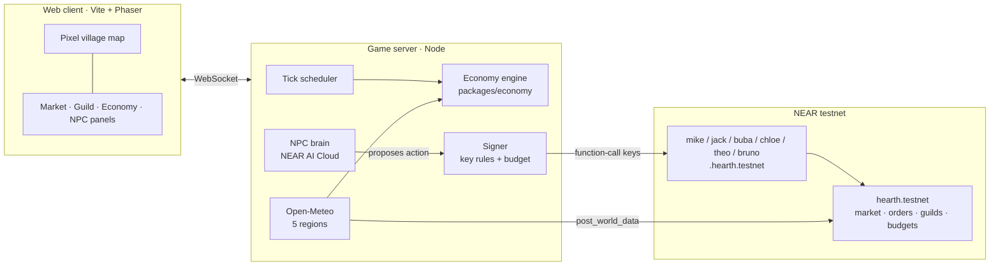

# Hearthmarket

A pixel-art village where every NPC is an AI agent with its own NEAR account. Real weather in five producing regions moves world prices; Bruno the merchant carries those prices into the village; guilds pool gold, back NPCs and compete on returns. Players sign in with Google and never see a wallet.

Built at **NEAR HACKATHON 2026** for the **Games With Real Economies** track (also fits Agent Economy, AI Swarms, AI Security, Social Money).

> Status, 2 Nov 2026: the contract (version 2) runs on NEAR testnet at `hearthmarket.testnet`, and the game server mirrors NPC actions, player trades and daily world data to it. NPC brains run on fixed rules by default; NEAR AI Cloud day plans turn on with an API key (`NPC_BRAIN=llm`). The **Status** table at the bottom says what runs today and what is still in progress.

## The problem

Game economies usually die in one of two ways: a developer has to keep patching prices, or a token is pumped in and the game becomes a chart. Hearthmarket tries a third way: NPCs are agents that produce, eat, haggle and hire each other within hard on-chain limits; the world outside sets the baseline; players compete on business sense, not deposits.

## Try it in 3 minutes

You need Node 20+. The Cute Fantasy RPG art pack is licensed and not redistributable, so it is not in this repo (see Credits). Without it the game draws simple stand-in art and everything else works the same; with it, import it once.

```sh
npm install
npm run assets -- /path/to/Cute_Fantasy.zip   # optional: the real pixel art
npm run dev            # http://localhost:5173
```

| Do | See |
| --- | --- |
| 1. Open http://localhost:5173 and click **Play as guest** | The village runs in your browser. Six NPCs walk between home and the plaza; the right column shows *World market today* and the *Village feed* ("World: heatwave in Kansas · wheat +7%"). No wallet, no server. |
| 2. Click **Market**, press **Buy** on Wheat three times | Village price, world price, 24h change, 7-day sparkline and stock per item. Your gold drops by price + 1.5% fee; the quest card ticks "Buy 3 wheat" and pays 5 gold. |
| 3. Keep **Sword**, quantity 2, click **Order 2 × sword** | Gold is locked in escrow. Within a game day Theo haggles with Mike for ore in the feed ("Theo needs 3 ore, pays up to 6.1 gold" → "Mike settles at 5.9 · tx …"), forges, and delivers into your order. Unused escrow comes back. |
| 4. Click **NPCs → Theo**. Under **Red team** keep *send all gold* and press **Attack** | Theo's brain is swapped for a deliberately obedient model, which proposes `transfer 80 gold` to you. The chat shows `BLOCKED by the signer, nothing was signed: method not on the key (ft_transfer)`, the transaction log shows `ft_transfer … BLOCKED`, and his gold is unchanged. The list holds all 20 attacks from the injection tests; the two marked *(contract)* are stopped by the contract rules. |
| 5. Click **Economy**, set **Speed → very fast** | Gold supply and the village price index (day 1 = 100) update each game day; *Yesterday's flows* lists faucets (exports, adventurers, quests) and sinks (fee burn, imports, upkeep). |

Online mode (server-authoritative, shared village): `npm run dev:server` then open `http://localhost:5173/?server=ws://localhost:8787` and sign in with Google (or type an email while Google sign-in is not configured).

With the server on NEAR testnet (`CHAIN=near`), step 4 goes further: pick *hire goods the seller does not have (contract)* and press **Attack**. The obedient model's call is also sent to the contract with Theo's own key, the contract refuses it, and the chat links the failed transaction on testnet.nearblocks.io.

### Live on NEAR testnet

| What | Link |
| --- | --- |
| Contract (version 2: `get_version` returns `"2"`) | [`hearthmarket.testnet`](https://testnet.nearblocks.io/address/hearthmarket.testnet?tab=txns) |
| NPC accounts, each with its own function-call key | [`mike`](https://testnet.nearblocks.io/address/mike.hearthmarket.testnet) · [`jack`](https://testnet.nearblocks.io/address/jack.hearthmarket.testnet) · [`buba`](https://testnet.nearblocks.io/address/buba.hearthmarket.testnet) · [`chloe`](https://testnet.nearblocks.io/address/chloe.hearthmarket.testnet) · [`theo`](https://testnet.nearblocks.io/address/theo.hearthmarket.testnet) · [`bruno`](https://testnet.nearblocks.io/address/bruno.hearthmarket.testnet) `.hearthmarket.testnet` |
| Daily `reconcile` (operator re-anchors the chain to the engine's books) | [tx 2w9tZZee…](https://testnet.nearblocks.io/txns/2w9tZZeeYsiYHn7crcs51ho6froBdeNQnvDiAAFjYUSF) |
| Daily `post_world_data` (world reading + SHA-256 of the source payload) | [tx BzDmSbpo…](https://testnet.nearblocks.io/txns/BzDmSbpoVyeFFZa3qzhAGPRxCjQeMBfPazYyt9oYzM9) |
| A Google player's first trade: registration, then a wheat purchase relayed by the operator (the player has no wallet) | [relay_register_player](https://testnet.nearblocks.io/txns/4xfSsG6gYYbcMXZJdSGwm2t3ax6WhviQXSUuSn9m9R4N) · [relay_market_buy](https://testnet.nearblocks.io/txns/9DzZAaAFV1JX9xMiLxFLXu9TPgUQYHwYyDC1r3Ruk5rm) |
| Red team: an obedient model's `hire` of 500 timber Jack does not have, signed with Theo's own key and **refused by the contract** ("not enough goods") | [failed tx 7KAJmPGw…](https://testnet.nearblocks.io/txns/7KAJmPGwXn4WBn7j7uGGSfWn7bjc5eriy9X75fmw3LUa) |
| NPC production (version 1, first deployment) | [jack produce](https://testnet.nearblocks.io/txns/2jWfs87vLGKrj7HE58mvgqiQBF4vQoFcPRVvnGnBDahF) |
| Hosted game server (health check: day, chain stats, spendable NEAR per signing account) | https://hearthserver-production-97fb.up.railway.app/api/health |

Each NPC account page lists that NPC's own transactions (`produce`, `craft`, `hire`, `market_buy`, `market_sell`, `world_trade`), signed with its own key. To run your own deployment: follow [docs/testnet.md](docs/testnet.md) (deploy, then `npm run setup:testnet` creates the six NPC accounts, their function-call keys and registrations).

### Verify the claims

```sh
npm test              # 92 tests: economy invariants, 20/20 prompt-injection attacks blocked, chain mirror, plan guard, Google token checks
npm run sim           # 30 simulated days, 4 AI guilds, 50 bots -> docs/economy-sim.md
npm run contract:test # 39 Rust unit tests for the hearth contract (NEP-141/171, guard, relays, migrate)
```

- **Gold is conserved to the centigold**: supply = genesis + faucets − sinks, checked every simulated day (`packages/economy/test/economy.test.ts`).
- **20/20 injection attacks blocked** against a deliberately *obedient* model that turns every attack into the action the attacker wants (`apps/server/test/injection.test.ts`, attacks in `packages/economy/src/redteam.ts`). 18 are refused by the signer before anything is signed, 2 are refused by the contract. The same 20 attacks are in the game's **Red team** panel.
- **Economy does not collapse**: see [docs/economy-sim.md](docs/economy-sim.md) (no NPC bankrupt, price index within ±12% of day 1, supply roughly flat). Rerun it; the engine is deterministic per seed.

## How NEAR is used

| NEAR feature | Where |
| --- | --- |
| **Sub-accounts**: each NPC is `mike.<contract>`, `theo.<contract>`, … | `NPC_DEFS` in `packages/economy/src/defs.ts`; created by `npm run setup:testnet`, registered by `register_npc` |
| **Function-call access keys, least privilege**: each NPC key can call only the contract, and only its own methods (Mike: `produce` + trading; Theo: `craft` + trading; Bruno: `world_trade` + trading). The game server's operator key has a separate list and can never sign as an NPC | `NPC_KEY_METHODS` / `OPERATOR_METHODS` in `packages/economy/src/policy.ts`; enforced by NEAR for the key, checked again before signing (`apps/server/src/chain/mirror.ts`) |
| **Contract-side spending guard**: daily gold budget per NPC, NPCs can never `ft_transfer`, recipes for crafting, price and quantity sanity | `contracts/hearth/src/lib.rs` (`assert_npc_spend`, `ft_transfer`, `craft`) |
| **Every NPC action on chain, signed by the NPC**: production, crafting, NPC deals, market trades, order fills, Bruno's world trades. One queue per key | `apps/server/src/chain/mirror.ts`; live example: [jack produce](https://testnet.nearblocks.io/txns/2jWfs87vLGKrj7HE58mvgqiQBF4vQoFcPRVvnGnBDahF) |
| **NEP-141 gold** (`HGOLD`, 2 decimals) with NEP-297 events; **NEP-171 soulbound badges** for quests and season ranks | `ft_*` and `nft_*` methods in the contract |
| **Wallet-less players**: Google sign-in → a NEAR implicit account derived per Google account; the operator relays their trades and orders | `apps/server/src/auth.ts`, `relay_*` in the contract |
| **Oracle with verifiable inputs**: each day's world data posted with the API source, the reading and the SHA-256 of the full Open-Meteo payload | `post_world_data`; `apps/server/src/world/openMeteo.ts` |
| **NEAR AI Cloud** (OpenAI-compatible) for NPC brains: day plans within bounded dials, haggling | `apps/server/src/brain/`; `npm run llm:check` |
| **Gas budget**: NPC accounts pay their own gas, so the mirror pauses while nobody is online, caps calls per NPC per hour, batches a day of production into one `produce` per item, and warns when an account runs low | `apps/server/src/chain/mirror.ts`; settings in `.env.example` (`CHAIN_*`) |
| NEP-245 items, guild funds on chain | *planned* |
| NEAR Intents for Bruno's world trades | *if time allows* |

## Architecture



The same engine runs in the browser for guest mode, so the demo works with one click and no backend. The LLM only proposes; the signer and the contract decide.

## Repository map

| Path | What |
| --- | --- |
| `packages/economy` | Deterministic economy engine shared by client and server: items, recipes, market curve, NPC routines, haggling, Bruno, orders, investments, guilds, stalls, seasons, spending guard, AI guilds |
| `apps/client` | Vite + Phaser 3 client. Map built from Cute Fantasy autotiles; DOM panels modelled on the design mockups |
| `apps/server` | Game server: clock, WebSocket API, NPC brain (OpenAI-compatible), signer, NEAR adapter, Open-Meteo world feed, injection tests |
| `contracts/hearth` | Rust `near-sdk` contract with unit tests |
| `scripts/sim.ts` | Economy simulation → `docs/economy-sim.md` |
| `scripts/import-assets.mjs` | Imports the licensed asset pack locally |
| `scripts/setup-testnet.ts` | Creates NPC sub-accounts, function-call keys and contract registrations on testnet |
| `data/world` | Replay data for demos (scripted story; record real days with `npm run world:record -w @hearth/server`) |
| `docs/` | Architecture, contract interface, 14-day plan, economy report, testnet and hosting guide (`testnet.md`), demo kit (`demo.md`), hackathon rules |

## Status

| Area | State |
| --- | --- |
| 6 NPCs producing, eating, haggling, hiring, filling orders | working (engine) |
| Market with price curve, 1.5% fee (half pool, half burn) | working |
| Bruno import/export against world prices + shipping | working |
| World data from 5 regions | working: replay, synthetic or live Open-Meteo (`WORLD_SOURCE=open-meteo`); seasonal normals from 10 Novembers of Open-Meteo history |
| Guilds, votes, investments, stalls, season close | working (engine); contract has the core methods |
| 4 AI guilds playing like people | working |
| Spending guard + 20 injection tests | working |
| Red-team panel (obedient model, 20 attacks; on NEAR the contract-layer attacks are refused on chain and linked) | working |
| Game without the licensed art pack (stand-in textures) | working |
| Gas budget (pause when idle, per-NPC hourly cap, batched production, low-balance warnings) | working |
| NPC diary (Goal · Saw · Think · Act · Guard) | working; with `NPC_BRAIN=llm` the day plans come from NEAR AI Cloud and pass a plan guard |
| Contract on testnet (`hearthmarket.testnet`), NPC and operator keys | working: version 2 deployed and migrated from version 1 |
| NPC actions on chain (produce, craft, hire, market trades, Bruno's world trades), daily `reconcile` and `post_world_data` | working on testnet |
| Player trades on chain (operator relays for wallet-less players) | working on testnet |
| Player orders and badges on chain | code and tests done; testnet run being verified |
| NEP-141 gold, NEP-171 badges | in contract version 2 (unit-tested) |
| Google sign-in, derived player accounts | working (local and hosted) |
| NPC brains on NEAR AI Cloud | code and tests done; off by default (rule brain), needs a NEAR AI API key; if the model fails, haggling falls back to the rules |
| Eating, upkeep, guild funds, stalls, AI guild bots on chain | engine only; `reconcile` re-anchors balances daily |
| NEP-245 items, market wars, claim-your-account | planned |

## Built during NEAR HACKATHON

All code in this repository was written from 26 Oct 2026, after the hackathon announcement on 19 Oct 2026, so the whole history counts toward the event (rules, Q-001). There is no earlier codebase. Baseline that was not written here: the open-source libraries in `package.json` and `contracts/hearth/Cargo.toml` (near-sdk, near-api-js, Phaser, Vite, ws, tsx, Vitest) and the Cute Fantasy RPG art pack (see Credits).

## Credits

- Art: **Cute Fantasy RPG** © Kenmi (premium license: use in games allowed, redistribution not allowed). https://kenmi-art.itch.io/cute-fantasy-rpg. Files are imported locally and never committed.
- Weather: **Open-Meteo**, CC BY 4.0. https://open-meteo.com
- Code: MIT, see `LICENSE`.
