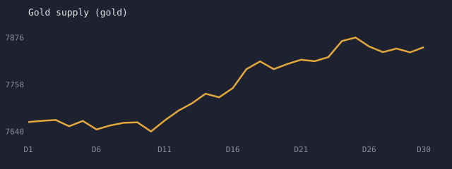
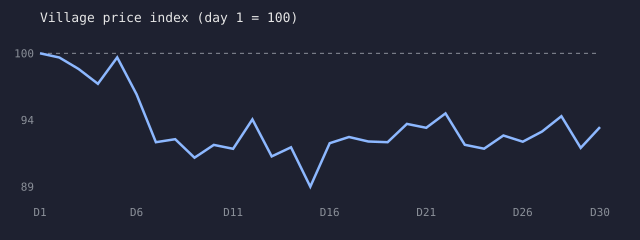

# Economy simulation report

Generated by `npm run sim -- --days 30 --seed 42 --bots 50 --world synthetic` on the engine in
`packages/economy`. Every number below comes from that run; rerun the command to reproduce it exactly
(the engine is deterministic for a given seed).

Setup: 6 NPCs, 4 AI guilds (Black Cats, Night Smiths, Golden Wheat, Red River),
50 bot players, 30 game days, synthetic world weather. Rules: `packages/economy/src/defs.ts`.

## Checks

| Check | Result | Value |
| --- | --- | --- |
| Gold is conserved (supply = genesis + faucets - sinks) | PASS | gap 0 centigold |
| No NPC bankrupt for more than 2 days in a row | PASS | longest streak 0 days |
| Village price index stays within ±12% of day 1 | PASS | min 88.6, max 100.0 |
| Gold supply growth | info | first half 1.5%, second half 1.5% |

## Gold flows over the run

| Flow | Gold |
| --- | ---: |
| Faucet: Bruno's exports to the world market | +571 |
| Faucet: travelling adventurers buying swords | +592 |
| Faucet: quest rewards | +355 |
| Faucet: starting gold of new players | +4100 |
| Sink: market fee burn (0.75% of volume) | -56 |
| Sink: Bruno's imports paid to the world | -0 |
| Sink: NPC workshop upkeep | -957 |
| Season pool income (0.75% of volume + stall rent) | 52 |
| Market volume | 8056 |
| Goods sinks | 15 tools worn out, 180 bread eaten |

## Final prices (gold per unit)

| Item | Village | World | Market stock / target |
| --- | ---: | ---: | ---: |
| Iron ore | 5.8 | 6.3 | 43 / 40 |
| Timber | 2.6 | 2.9 | 43 / 40 |
| Wheat | 1.9 | 2.2 | 65 / 60 |
| Bread | 2.7 | - | 36 / 24 |
| Tools | 8.7 | 10.0 | 12 / 10 |
| Sword | 17.2 | - | 9 / 8 |

## NPC balances (gold)

| NPC | Day 1 | Day 15 | Day 30 |
| --- | ---: | ---: | ---: |
| Mike (Miner) | 106 | 397 | 434 |
| Jack (Lumberjack) | 97 | 258 | 307 |
| Buba (Farmer) | 91 | 349 | 407 |
| Chloe (Baker) | 93 | 206 | 114 |
| Theo (Smith) | 79 | 125 | 237 |
| Bruno (Merchant) | 395 | 289 | 226 |

## Guild ranking at the end

| # | Guild | Return on fund | Members |
| --- | --- | ---: | ---: |
| 1 | Golden Wheat | 0.2% | 20 |
| 2 | Night Smiths | 0.0% | 20 |
| 3 | Red River | -0.0% | 20 |
| 4 | Black Cats | -0.2% | 19 |

Season length is 14 days; returns restart from the fund value at each season close.

## Daily series

| Day | Gold supply | Price index | Wheat | Ore | Bread | Sword |
| ---: | ---: | ---: | ---: | ---: | ---: | ---: |
| 1 | 7669 | 100.0 | 1.9 | 5.8 | 3.0 | 19.9 |
| 2 | 7674 | 99.6 | 2.1 | 5.7 | 3.0 | 18.9 |
| 3 | 7679 | 98.7 | 2.1 | 5.8 | 2.7 | 19.9 |
| 4 | 7662 | 97.4 | 2.1 | 5.8 | 2.6 | 19.9 |
| 5 | 7680 | 99.6 | 2.1 | 5.8 | 2.7 | 21.1 |
| 6 | 7661 | 96.5 | 2.1 | 5.7 | 2.6 | 19.9 |
| 7 | 7673 | 92.4 | 2.1 | 5.9 | 2.6 | 13.9 |
| 8 | 7682 | 92.6 | 2.0 | 5.8 | 2.9 | 14.3 |
| 9 | 7687 | 91.1 | 2.0 | 5.3 | 2.9 | 15.3 |
| 10 | 7663 | 92.2 | 1.9 | 5.3 | 3.0 | 15.3 |
| 11 | 7692 | 91.8 | 1.9 | 5.2 | 3.1 | 15.9 |
| 12 | 7716 | 94.3 | 2.0 | 5.4 | 3.0 | 15.9 |
| 13 | 7739 | 91.2 | 2.0 | 5.3 | 3.0 | 13.9 |
| 14 | 7767 | 92.0 | 2.0 | 5.6 | 3.0 | 14.8 |
| 15 | 7757 | 88.6 | 2.0 | 5.4 | 2.6 | 14.8 |
| 16 | 7785 | 92.3 | 2.1 | 5.7 | 2.8 | 15.9 |
| 17 | 7831 | 92.8 | 2.0 | 6.2 | 2.6 | 15.3 |
| 18 | 7852 | 92.5 | 2.0 | 5.8 | 2.6 | 15.9 |
| 19 | 7831 | 92.4 | 1.9 | 5.7 | 2.9 | 15.9 |
| 20 | 7848 | 94.0 | 2.0 | 5.8 | 2.9 | 17.2 |
| 21 | 7863 | 93.6 | 1.9 | 5.6 | 3.1 | 16.5 |
| 22 | 7858 | 94.9 | 1.9 | 5.8 | 3.2 | 16.5 |
| 23 | 7871 | 92.2 | 2.0 | 6.0 | 3.1 | 14.3 |
| 24 | 7915 | 91.8 | 1.9 | 6.3 | 2.9 | 14.8 |
| 25 | 7923 | 93.0 | 1.9 | 6.3 | 2.9 | 14.8 |
| 26 | 7899 | 92.4 | 1.9 | 6.0 | 2.9 | 14.8 |
| 27 | 7883 | 93.3 | 2.0 | 6.0 | 3.1 | 14.3 |
| 28 | 7896 | 94.6 | 1.9 | 6.3 | 3.0 | 15.3 |
| 29 | 7887 | 91.9 | 1.9 | 5.7 | 2.8 | 15.9 |
| 30 | 7904 | 93.7 | 1.9 | 5.8 | 2.7 | 17.2 |
