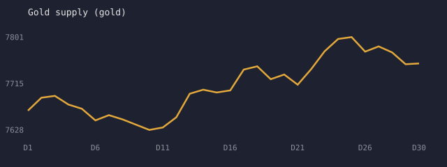
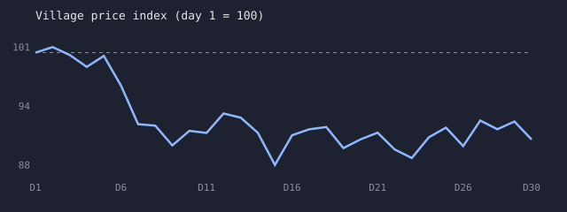

# Economy simulation report

Generated by `npm run sim -- --days 30 --seed 42 --bots 50 --world synthetic` on the engine in
`packages/economy`. Every number below comes from that run; rerun the command to reproduce it exactly
(the engine is deterministic for a given seed).

Setup: 6 NPCs, 4 AI guilds (Black Cats, Night Smiths, Golden Wheat, Red River),
50 bot players, 30 game days, synthetic world weather. Rules: `packages/economy/src/defs.ts`.

## Checks

| Check | Result | Value |
| --- | --- | --- |
| Gold is conserved (supply = genesis + faucets - sinks) | PASS | gap 0 centigold |
| No NPC bankrupt for more than 2 days in a row | PASS | longest streak 0 days |
| Village price index stays within ±12% of day 1 | PASS | min 88.1, max 100.6 |
| Gold supply growth | info | first half 0.5%, second half 0.7% |

## Gold flows over the run

| Flow | Gold |
| --- | ---: |
| Faucet: Bruno's exports to the world market | +618 |
| Faucet: travelling adventurers buying swords | +364 |
| Faucet: quest rewards | +360 |
| Faucet: starting gold of new players | +4100 |
| Sink: market fee burn (0.75% of volume) | -54 |
| Sink: Bruno's imports paid to the world | -0 |
| Sink: NPC workshop upkeep | -936 |
| Season pool income (0.75% of volume + stall rent) | 50 |
| Market volume | 7601 |
| Goods sinks | 15 tools worn out, 180 bread eaten |

## Final prices (gold per unit)

| Item | Village | World | Market stock / target |
| --- | ---: | ---: | ---: |
| Iron ore | 5.2 | 6.3 | 52 / 40 |
| Timber | 2.5 | 2.9 | 45 / 40 |
| Wheat | 1.9 | 2.2 | 65 / 60 |
| Bread | 2.9 | - | 32 / 24 |
| Tools | 8.7 | 10.0 | 12 / 10 |
| Sword | 15.3 | - | 12 / 8 |

## NPC balances (gold)

| NPC | Day 1 | Day 15 | Day 30 |
| --- | ---: | ---: | ---: |
| Mike (Miner) | 106 | 399 | 432 |
| Jack (Lumberjack) | 97 | 268 | 310 |
| Buba (Farmer) | 91 | 358 | 426 |
| Chloe (Baker) | 93 | 202 | 91 |
| Theo (Smith) | 79 | 170 | 244 |
| Bruno (Merchant) | 391 | 253 | 181 |

## Guild ranking at the end

| # | Guild | Return on fund | Members |
| --- | --- | ---: | ---: |
| 1 | Golden Wheat | 0.2% | 20 |
| 2 | Red River | 0.0% | 20 |
| 3 | Night Smiths | 0.0% | 20 |
| 4 | Black Cats | -0.0% | 19 |

Season length is 14 days; returns restart from the fund value at each season close.

## Daily series

| Day | Gold supply | Price index | Wheat | Ore | Bread | Sword |
| ---: | ---: | ---: | ---: | ---: | ---: | ---: |
| 1 | 7664 | 100.0 | 1.9 | 5.8 | 3.0 | 19.9 |
| 2 | 7688 | 100.6 | 2.1 | 5.7 | 3.0 | 19.9 |
| 3 | 7692 | 99.7 | 2.1 | 5.8 | 2.7 | 21.1 |
| 4 | 7676 | 98.5 | 2.1 | 5.8 | 2.6 | 21.1 |
| 5 | 7667 | 99.6 | 2.1 | 5.8 | 2.7 | 21.1 |
| 6 | 7646 | 96.5 | 2.1 | 5.7 | 2.6 | 19.9 |
| 7 | 7656 | 92.4 | 2.1 | 5.9 | 2.6 | 13.9 |
| 8 | 7648 | 92.2 | 2.0 | 5.8 | 2.9 | 13.9 |
| 9 | 7638 | 90.1 | 2.0 | 5.3 | 2.9 | 14.3 |
| 10 | 7628 | 91.7 | 1.9 | 5.3 | 3.0 | 14.8 |
| 11 | 7633 | 91.5 | 1.9 | 5.2 | 3.1 | 15.3 |
| 12 | 7652 | 93.5 | 2.1 | 5.4 | 2.9 | 15.3 |
| 13 | 7696 | 93.1 | 2.1 | 5.6 | 2.8 | 15.3 |
| 14 | 7703 | 91.5 | 2.1 | 5.7 | 2.8 | 14.3 |
| 15 | 7698 | 88.1 | 1.9 | 5.3 | 2.7 | 14.8 |
| 16 | 7702 | 91.2 | 2.0 | 5.5 | 2.6 | 14.8 |
| 17 | 7741 | 91.9 | 1.9 | 6.1 | 2.5 | 15.3 |
| 18 | 7747 | 92.1 | 2.0 | 5.7 | 2.6 | 15.3 |
| 19 | 7723 | 89.9 | 1.9 | 5.7 | 2.7 | 12.8 |
| 20 | 7731 | 90.8 | 2.0 | 5.7 | 2.7 | 13.5 |
| 21 | 7712 | 91.5 | 1.9 | 5.5 | 2.7 | 13.9 |
| 22 | 7741 | 89.7 | 2.0 | 5.7 | 2.6 | 14.3 |
| 23 | 7775 | 88.8 | 2.0 | 5.7 | 2.6 | 15.3 |
| 24 | 7798 | 91.0 | 1.9 | 5.9 | 2.6 | 15.3 |
| 25 | 7801 | 92.0 | 1.9 | 6.1 | 2.7 | 15.3 |
| 26 | 7774 | 90.1 | 2.0 | 5.8 | 2.7 | 15.3 |
| 27 | 7784 | 92.8 | 2.0 | 6.0 | 3.0 | 15.3 |
| 28 | 7773 | 91.9 | 1.9 | 5.8 | 3.0 | 14.8 |
| 29 | 7751 | 92.7 | 1.9 | 6.1 | 2.9 | 14.8 |
| 30 | 7752 | 90.8 | 1.9 | 5.2 | 2.9 | 15.3 |
